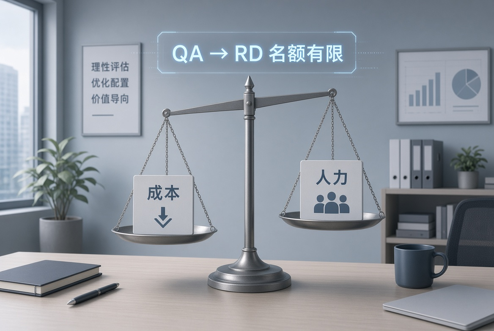
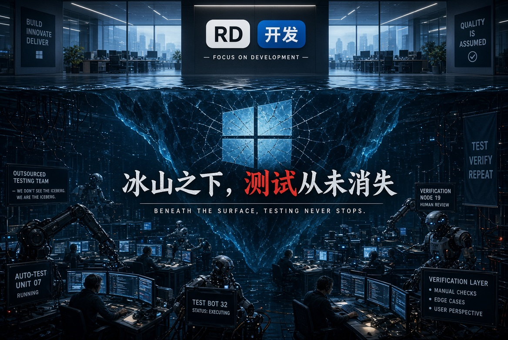

最近看到有消息说字节现在正在进行测试转开发的尝试，但属于小范围灰度试点，并非全公司一刀切。

字节官方并没有任何说明，我找了一下信源，基本属于二次加工二次传播，真实性存疑，但无风不起浪，这件事应该还是有一定的可信度的。

消息来源

* 掘金：《突发！字节内部大调整，QA直接转研发了？》（2026-09-28 左右）
* 腾讯云开发者社区 / 掘金：《QA 正在被“升级”，不是被“取代”：字节这次调整在说哪件事》（2026-09-29）

简单说明一下我的观点，这件事情的本质还是在降低研发成本，而不是去提升产品质量。这是一种变相裁员和降薪的方式，而且并非行业首创。

<!--more-->

## 太阳底下没有新鲜事

我的第一反应是这不是什么新鲜事，我记得当年，大约是2008-2010年之间，腾讯有的团队就已经做过类似的事情。

他们要求测试人员在一个评估周期内（大概是半年）完成转开发的要求，否则就进行强制优化。

当初应该是有一些内部的测试员工因此而离职的。

但人走了之后活还是要继续干的，于是外包员工入场，完成了降本增效的要求，并且质量在一定程度上没有断崖式下跌的风险。

不过这是某些部门行为，不是公司级的战略目标，所以声浪不大，时过境迁，当初泛起的涟漪现在应该没人记得了。

所以这次字节借助AI coding的契机，推动测试转开发，表面上看是通过AI的赋能，给测试上了外挂，让测试有了开发的能力，可以真正的测试左移，让测试去干开发的活，并且交付效率和质量都不会有明显劣势化，但实际上我认为还是在进行变相裁员和降薪，从而降低研发成本。

## 变相裁员和降薪

跟世界上任何的事情一样，测试转开发的成功率并非百分之百。我觉得字节的正编测试人员在技术水平上大概率会超过行业的平均值，但在身份和工作内容转变的过程中，还是应该有一些人无法适应，从而被人为淘汰。

又或者测试转开发本身就是有名额限制的，比如10个QA去竞争5个RD席位，那么剩下的5个人就被强制淘汰掉了。

另外测试转RD还需要重新面试，我说你不符合岗位要求你就不符合，谁管你肚子里到底有几碗粉。

另外由于测试和开发合并了，都叫做开发，活就只有那么多，那么之前的研发人员可能就会被优化调整，持续的变相裁员。

团队合并之后，人人都是研发，但同样的，每个人都是测试，那些不愿意做测试的研发人员可能因此受到较低的评价，从而成为重点优化的目标。

薪资方面就更好理解了，测试的薪资比研发要低，测试转开发之后薪资不变的可能性还是比较高的，这样研发的整体薪资就会被拉低，从而影响到老员工的加薪以及新员工薪资包的标准。

在例行调薪的时候，由于测试转过来的研发薪资较低，所以可能会拿到更多的配额，这样原先开发的加薪可能就会变少。

所以长期来看，这是对研发团队的变相降薪。

## 质量正变得越来越重要？

最近苹果App Store的上架明显变得更加严格了，可能是因为 AI 降低了app开发的门槛，无数的app现在开始疯狂涌入。

所以不出意外，以后的竞品可能会越来越多，竞争会越来越激烈。

所以产品的品质将变得更加重要。

品质无非就是更新鲜的思路，更吸引人的 UI 和交互，更丝滑的性能，更好的质量，其中后面两个跟QA直接相关。

所以为了能在日益激烈的竞争中获得优势，质量把控将变得越来越重要？

大部分人的答案可能是肯定的，但是我觉得字节测试转开发的做法出发点还是成本，而不是质量。甚至很有可能在短期内，相关产品还有质量退化的风险。

但质量的退化会显著的影响营收吗？对巨头来说可能不会。

就算AI Coding再怎么厉害，也很难有人能够一口气复制一个抖音出来。

毕竟这是工程和运营问题，不仅仅是代码问题。

## 测试岗位会消失吗？

当初微软将所有的功能测试都转成了测试开发，从表面上看测试这个岗位是消失了。顺便提一下，当时windows系统的质量明显下降，各种补丁频繁推送，可能还有人会有印象。

但是微软一直有测试外包的传统，冰山之下，测试岗位依然存在。

另外测试行为也不会消失，毕竟很多产品的最终用户是人类，人类验证人类的产出比机器验证人类的产出还是会更加合理一点。

只不过测试的工作内容可能会更加像机器一些，就像是现在各个公司想办法把机器包装的更像人类一样。

